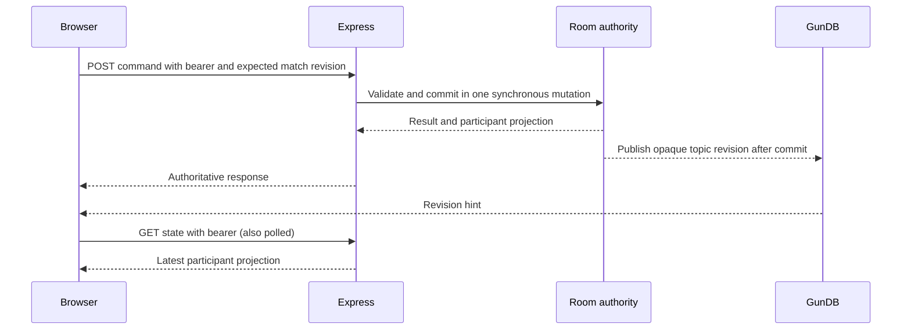

# Broadside architecture and specification checkpoint

Approved by the user before gameplay implementation. Baseline import 7b45f7f on `feature/broadside-3d-sdd`. Source was the extracted Downloads prototype with no Git metadata. The download is intact.

## Discovery and baseline

- Node 24.22.2, OpenSpec 1.17.0 using the installed Node 24 toolchain. The default Node 26 does not expose the installed OpenSpec shim.
- `npm run check` ran after dependency installation. Tests passed 5/5. TypeScript stopped the build at `src/main.ts:265` with null and discriminated-union errors. Vite bundling was therefore not reached.
- Baseline strict validation failed all four items. Three base specs lack Purpose and the initial change lacks a delta. Keep that active historical draft until its outstanding work is reconciled. Validate the six new deltas individually.
- Ollama lists `gpt-oss:20b` and `qwen3.5:4b`. See [local review evidence](goldfish/README.md).
- Retain server arbitration, Vite, Express, GunDB, Three.js, the coordinate convention and polling recovery. Replace the monolithic client, public match-detail payload, token-in-URL reads and immediate combat.

## Decisions for approval

1. Single loopback-by-default Node authority with ephemeral storage and a documented restart boundary. Strict TypeScript for rules, use cases, transport contracts and client.
2. GunDB carries opaque room revision hints. Authenticated HTTP is authoritative for snapshots, chat and commands. Use a 10-second heartbeat, pause after 30 seconds of absence and expire after 90 seconds. Reconnect within that window preserves the seat.
3. Classic 10×10 rules, optional drag/rotate placement and random deployment, two explicit ready votes, single alternating attacks and two-player rematch consent. Only fully sunk enemy geometry is revealed.
4. Orthographic Three.js with readable effects and keyboard targeting. Evaluate licensed assets and use original procedural silhouettes if suitable assets are unavailable. Verify against the proposed 1080p frame and scene budgets.
5. Review uses a fresh local inference request for each gate with explicit inputs. Decisions on findings are recorded by the author and the human checkpoint remains explicit.

## Contracts and sequence

`POST /api/sessions` creates a server credential and enters the queue. `GET /api/state` reads the room and renews the lease. `POST /api/commands` accepts a tagged command `ready | fire | chat | rematch | leave` with a command ID and scoped room ID. Ready and fire also carry the current match ID and expected match revision. Room revision tracks public-facing changes including presence and chat. Match revision tracks gameplay changes only. Gun carries `{revision: number}` under a random room topic. The client ignores stale HTTP responses, coalesces hint-driven reads and polls independently. Waiting and placement expiry close the room. During combat, explicit leave or single-seat expiry against a present seat ends in forfeit. Both absent at expiry closes without a winner.

### Lease and retry semantics

| Interval from last authenticated contact | Behavior |
| --- | --- |
| Every 10 seconds | Browser requests state while a session is active. Retry transient errors with bounded backoff and an immediate refresh on browser reconnect. |
| At 30 seconds | Server marks the seat absent. Keep its place and pause ready and fire commands. |
| At 90 seconds | Expire the seat. Sweep before command authorization so an expired credential cannot renew its lease. |
| Five minutes from finish | Close the room and delete its ephemeral state if a rematch has not started. |

Use `/api/v1` for the new contract. Validate tagged request DTOs at runtime before passing them to the use cases. An expired or missing credential returns 401, stale state or phase conflicts return 409, invalid input returns 400, and a rate-limited command returns 429. For simultaneous ready submissions, the stale client reloads and resubmits the same unchanged placement only after validating that it remains eligible. Refresh completion is scoped to the active session, room and revision.

## Execution and traceability

| Change | Requirement → decision | Planned implementation | Verification to attach |
| --- | --- | --- | --- |
| [Architecture](../openspec/changes/archive/2026-11-11-establish-authoritative-core/proposal.md) | Participant snapshots, Command serialization → A | server/application, server/http, server/repositories | API contract tests for invalid credentials, stale revisions, command retry and unchanged state; strict client and server build. |
| [Rooms and recovery](../openspec/changes/archive/2026-11-11-pair-and-recover-rooms/proposal.md) | Automatic FIFO pairing, Reconnect and notification recovery → R | server/rooms, server/realtime, src/session | Fake-clock lifecycle and concurrent pairing tests plus browser relay-offline and reload checks. |
| [Fleet and combat rules](../openspec/changes/archive/2026-11-11-complete-fleet-and-combat/proposal.md) | Battleship rules, Fleet secrecy → G | server/domain, src/placement | Seeded placement invariant tests, edge/overlap validation, repeated or out-of-turn shots, complete match replay, and privacy assertions. |
| [Tactical 3D and effects](../openspec/changes/archive/2026-11-11-render-orthographic-battlefield/proposal.md) | Interactive naval battlefield, Combat effects and frame budget → V | src/rendering, src/input, src/hud | Playwright projection/input and render smoke checks; 60-second GPU-enabled benchmark and scene teardown check. |
| [Chat and rematches](../openspec/changes/archive/2026-11-11-finish-match-experience/proposal.md) | Participant chat, Rematch and visible connection state → U | server/chat, server/rematch, src/hud | Two-context chat, rate and capacity checks; rejoin, rematch race and stale-round checks; desktop and tablet screenshots. |
| [Verification and local review](../openspec/changes/archive/2026-11-11-verify-and-demonstrate-sdd/proposal.md) | Independent review gates, Reproducible verification → Q | scripts/review, tests, docs/SDD-DEMO.md | Review harness tests for malformed output and isolation; strict OpenSpec, full build, unit/integration and browser evidence, performance report and drift review. |

Core → rooms → rules → room experience. Tactical rendering can begin after core contracts and integrates after rules. Final evidence and archive follow integration. The review harness is checkpoint tooling and precedes gameplay implementation. Update links from planned locations to actual code and evidence as each change is verified.

The six verified changes are archived. See [implementation and test evidence](VERIFICATION.md).
